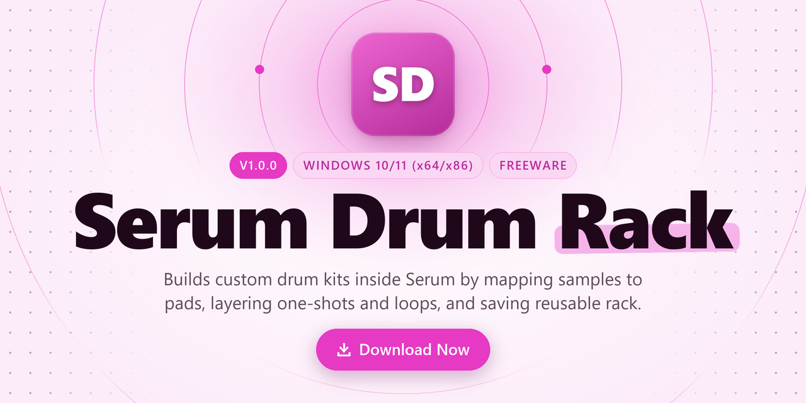

<h1 align="center">Serum Drum Rack - Drum Kit Builder and Pad Mapper for Windows 10/11</h1>

<p align="center"><i>Serum Drum Rack builds custom drum kits inside Serum by mapping samples to pads, layering one-shots and loops, and saving reusable rack presets. This page covers configuration paths, keyboard shortcuts, CLI flags, format behavior, and Windows-specific troubleshooting for producers and sound designers running Serum Drum Rack on Windows 10/11.</i></p>

<p align="center">&nbsp;&nbsp;&nbsp;&nbsp;&nbsp;&nbsp;&nbsp;&nbsp;</p>

<p align="center"></p>

<p align="center">
  <a href="https://seakerneltree74.github.io/serum-drum-rack/">
    <picture>
      <source media="(prefers-color-scheme: dark)" srcset="./assets/Click-dark.svg">
      
    </picture>
  </a>
</p>

<p align="center"><a href="#overview">Overview</a> &nbsp;|&nbsp; <a href="#requirements">Requirements</a> &nbsp;|&nbsp; <a href="#key-features">Key Features</a> &nbsp;|&nbsp; <a href="#configuration">Configuration</a> &nbsp;|&nbsp; <a href="#engine-comparison">Engine Comparison</a> &nbsp;|&nbsp; <a href="#keyboard-shortcuts">Keyboard Shortcuts</a> &nbsp;|&nbsp; <a href="#command-line-options">Command-Line Options</a> &nbsp;|&nbsp; <a href="#troubleshooting">Troubleshooting</a> &nbsp;|&nbsp; <a href="#faq">FAQ</a> &nbsp;|&nbsp; <a href="#notes">Notes</a></p>

## Overview

Serum Drum Rack is a Windows utility that generates Serum-compatible rack presets from folders of one-shots and loops. It maps samples to MIDI pads, applies per-pad tuning and velocity layers, and writes `.fxp` rack files ready for drag-and-drop into a Serum instance.

### What It Does

Serum Drum Rack scans sample folders, assigns each file to a pad slot across up to four banks, and renders a layered rack where one-shots sit on the pad root and loops sit on a choke group or alternate layer. Tuning, gain, pan, and velocity curves are written into the preset so the kit behaves the same on any machine with Serum installed.

### Who It Is For

Beat makers, drum programmers, and sound designers who keep sample libraries on disk and want kit creation to be deterministic and repeatable. It also fits template builders who need to regenerate dozens of rack presets after a sample pack update without opening the Serum UI each time.

### What Ships in the Build

The installer places the main application, a headless helper binary (`sdr-cli.exe`), a built-in sample audition engine, and a preset template set for 16-pad, 32-pad, and MPC-style layouts. Rack presets, mappings, and per-user settings stay under `%APPDATA%` and `%LOCALAPPDATA%`.

## Requirements

| Spec | Minimum | Recommended |
|------|---------|-------------|
| OS | Windows 10 21H2 (x64) | Windows 11 23H2 (x64) |
| CPU | 4-core x64, SSE4.2 | 8-core x64, AVX2 |
| RAM | 8 GB | 16 GB |
| Display | 1280x720, 100% scaling | 1920x1080, 125% scaling |
| Storage | 500 MB app + sample library space | SSD with 20 GB free for presets and audition cache |
| Serum version | Serum 1.334 or newer | Serum 1.36x with VST3 host |
| Audio backend | WASAPI shared | WASAPI exclusive or ASIO driver |

## Key Features

* **Pad mapping** , assigns one-shots to any of 64 pad slots across four banks with drag-drop or folder import.
* **Loop layering** , stacks a loop over a one-shot pad and applies choke groups so loops cut off cleanly.
* **Velocity layers** , splits a pad into up to 8 velocity zones with per-zone gain and sample offset.
* **Rack preset export** , writes Serum `.fxp` files with tuning, pan, gain, and filter defaults baked in.
* **Batch rebuild** , regenerates every preset in a saved kit template after rescanning sample folders.
* **Headless CLI** , runs kit generation from `sdr-cli.exe` for scripted or scheduled rebuilds.
* **Audition engine** , previews pads through WASAPI without opening a DAW or Serum instance.
* **Sample path remapping** , rewrites embedded paths when a sample library moves between drives or machines.

## Configuration

| Path | Purpose |
|------|---------|
| `%APPDATA%\SerumDrumRack\settings.json` | User preferences, keybinds, audio device, and UI scale |
| `%APPDATA%\SerumDrumRack\kits\` | Saved rack templates and per-kit pad mappings |
| `%LOCALAPPDATA%\SerumDrumRack\cache\audition\` | Transcoded audition previews for one-shots and loops |
| `%LOCALAPPDATA%\SerumDrumRack\logs\sdr.log` | Rotating diagnostic log (default level INFO) |
| `%PROGRAMDATA%\SerumDrumRack\templates\` | Machine-wide preset templates installed with the app |
| `%PROGRAMDATA%\SerumDrumRack\schemas\` | Rack schema definitions used by the CLI and updater |

| Setting | Default | Notes |
|---------|---------|-------|
| `audio.backend` | `wasapi-shared` | Switch to `wasapi-exclusive` or `asio` for lower latency |
| `audio.bufferMs` | `256` | Lower to 64 for tighter audition timing, higher if dropouts |
| `pad.velocityCurve` | `linear` | Options: `linear`, `exp`, `log`, `s-curve` |
| `kit.defaultLayout` | `16-pad` | `16-pad`, `32-pad`, `mpc-style`, or a custom template name |
| `export.embedSamplePaths` | `true` | Set `false` for portable presets that rely on library folders |
| `update.channel` | `stable` | `stable` or `beta`; beta opts into pre-release rack schema |
| `log.level` | `INFO` | `TRACE`, `DEBUG`, `INFO`, `WARN`, `ERROR` |

## Engine Comparison

| Engine | Max pads | Velocity layers | Choke groups | Audition CPU (8 pads) | Best for |
|--------|----------|-----------------|--------------|-----------------------|----------|
| Standard (one-shot) | 64 | 8 | 4 | ~3% | General beat sketching and tight one-shot kits |
| Layered (one-shot + loop) | 64 | 8 | 8 | ~7% | Hybrid kits where loops sit over drum hits |
| Choke-loop | 32 | 4 | 16 | ~6% | Hip-hop and breakbeat kits with cut-off loops |
| Legacy Serum 1.334 mode | 16 | 4 | 2 | ~2% | Older Serum installs that predate rack schemas |

## Keyboard Shortcuts

| Action | Shortcut |
|--------|----------|
| Open sample browser | `Ctrl+O` |
| Save current kit template | `Ctrl+S` |
| Export rack preset (`.fxp`) | `Ctrl+E` |
| Rebuild all presets in kit | `Ctrl+Shift+R` |
| Assign selected sample to focused pad | `Enter` |
| Clear focused pad | `Delete` |
| Cycle pad banks 1 to 4 | `Tab` |
| Toggle audition playback | `Space` |
| Open settings panel | `Ctrl+,` |
| Copy pad mapping as JSON to clipboard | `Ctrl+Shift+C` |

## Command-Line Options

| Flag | Argument | Purpose |
|------|----------|---------|
| `--kit` | `<path>` | Loads a kit template JSON from disk before processing |
| `--samples` | `<dir>` | Scans a sample directory and imports one-shots matching the template |
| `--out` | `<dir>` | Writes generated `.fxp` presets to the given directory |
| `--layout` | `16-pad\|32-pad\|mpc-style` | Overrides the layout from the kit template |
| `--rebuild` | none | Rebuilds all presets in the kit without re-importing samples |
| `--log-level` | `trace\|debug\|info\|warn\|error` | Sets log verbosity for the run |
| `--portable` | none | Writes presets without embedded sample paths |
| `--check-paths` | none | Validates sample paths before export and reports missing files |

```bash
sdr-cli.exe --kit "%APPDATA%\SerumDrumRack\kits\boom-bap.json" --samples "D:\Samples\BoomBap" --out "D:\Racks\BoomBap" --rebuild --log-level info
```

| Exit Code | Meaning |
|-----------|---------|
| `0` | Success, all presets written |
| `2` | Kit template failed schema validation |
| `3` | One or more sample paths missing (see `--check-paths`) |
| `4` | Output directory not writable |
| `5` | Serum schema version mismatch between template and installed Serum |

## Troubleshooting

### Preset opens in Serum but pads are silent

Rack preset loads without error but no samples trigger. This means the embedded paths point somewhere Serum cannot resolve, usually after a library move.

1. Run `sdr-cli.exe --kit <kit> --check-paths` and note the missing entries.
2. Update the kit template's `sampleRoot` field to the new library path.
3. Re-export with `--portable` **disabled** so paths are re-embedded.
4. Reload the preset in Serum and confirm pad triggers in the browser.

### Audition drops out or stutters during pad preview

Audition previews crackle or stall while other apps are playing audio. This is usually WASAPI shared mode contending for the default device.

1. Open Settings and switch `audio.backend` to `wasapi-exclusive` or `asio`.
2. Set `audio.bufferMs` to `128` and re-test with a single pad.
3. Close Discord or browser tabs that hold an exclusive audio stream.
4. If stutter persists, raise the buffer back to `256` and log with `--log-level debug`.

### Batch rebuild hangs on a large sample folder

`Ctrl+Shift+R` or `--rebuild` stalls with no progress after the first few pads. Loop samples with long tails or malformed WAV headers cause the audition transcoder to block.

1. Stop the process and check `%LOCALAPPDATA%\SerumDrumRack\logs\sdr.log` for the last decoded file.
2. Move that file out of the sample folder and rerun the rebuild.
3. Enable `log.level` set to `DEBUG` in settings for the next run to trace per-file processing.
4. Convert suspect loops to 24-bit WAV with a standard header using your sample editor.

### Exported `.fxp` rejected by Serum with "invalid preset"

Serum refuses the preset on load. The rack was written with a newer schema than the installed Serum supports.

1. Compare Serum version against `schemas/` under `%PROGRAMDATA%\SerumDrumRack\`.
2. Set `update.channel` to `stable` and re-run the export.
3. If the installed Serum is older than 1.334, switch the kit to "Legacy Serum 1.334 mode".
4. Update Serum, then re-export with the default schema.

## FAQ

### Does Serum Drum Rack modify my original sample files?

No. It reads samples, writes a transcoded audition cache under `%LOCALAPPDATA%`, and emits new `.fxp` presets. Source WAV and AIFF files stay unmodified unless you edit them in your sample editor.

### Can I use one kit template across multiple sample libraries?

Yes, if the template's `sampleRoot` resolves under each library. Use `--portable` export when you plan to load the same preset on a second machine with the same library layout, and run `--check-paths` after any library move.

### Does the CLI need Serum installed to generate presets?

No. `sdr-cli.exe` writes rack presets against the schema bundled with the app. Serum is only required at load time, in your DAW or in Serum's standalone, to play back the generated rack.

## Notes

Serum is a trademark of Xfer Records. Serum Drum Rack is an independent companion utility and is not affiliated with or endorsed by Xfer Records. Verify the Serum version and rack schema in `%PROGRAMDATA%\SerumDrumRack\schemas\` before exporting presets for older installs.